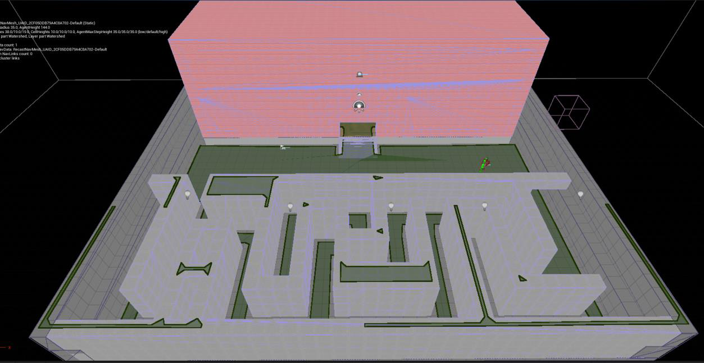
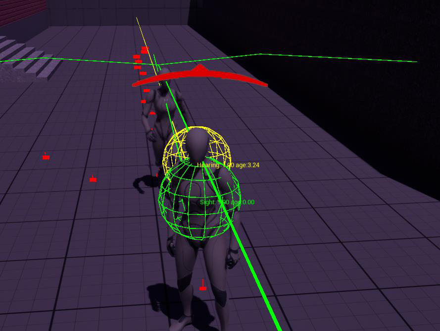
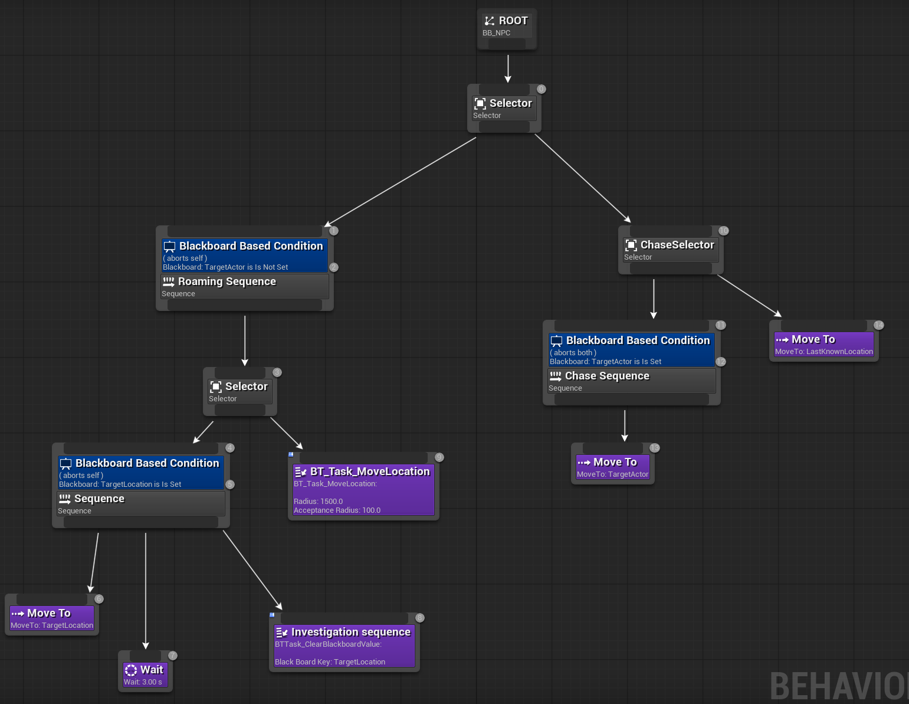
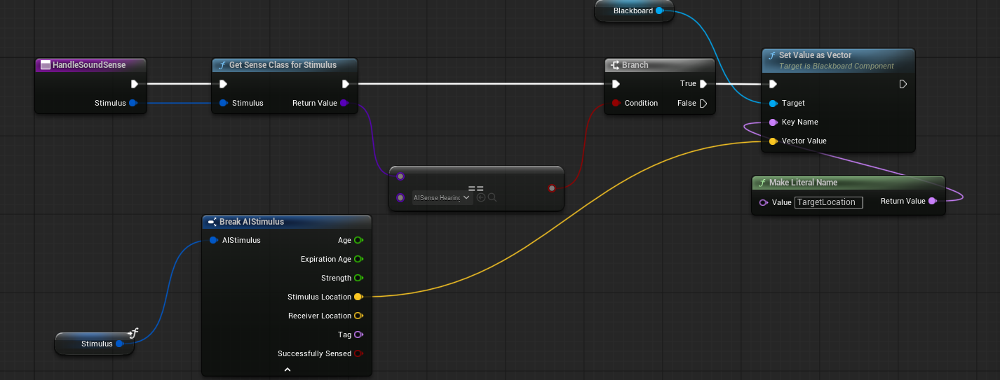

# AI Chaser Sandbox

Final Year Project developed in Unreal Engine 5.6.1 exploring perception-driven enemy AI for stealth and survival-horror gameplay.

## Overview
## Screenshots

### Test Environment

Custom maze and apartment-style environment used to test navigation, detection, chasing and investigation behaviour.

### AI Perception

AI Perception debug view showing the enemy's sight and hearing detection ranges.

### Behaviour Tree

Behaviour Tree controlling the priority between roaming, chasing and investigation behaviour.

### Sound Detection Blueprint

Blueprint logic used to process hearing stimuli, retrieve the sound location and update the Blackboard so the AI can investigate the source.
This project demonstrates enemy AI capable of detecting and responding to the player through both sight and sound.

The AI can:

- Patrol and roam through the environment
- Detect the player using line of sight
- Detect player footsteps and landing sounds
- Chase the player when visually detected
- Investigate the player's last known location
- Return to roaming after losing the player
- React differently while the player is crouching
- Operate as a hearing-only enemy variant

## AI Architecture

The main AI system uses:

- Unreal Engine 5.6.1
- Blueprint scripting
- Custom AI Controller
- Behaviour Trees
- Blackboard
- AI Perception
- Sight and Hearing senses
- Navigation Mesh
- Animation Notifies

## Behaviour

The general behaviour flow is:

Patrol / Roam  
↓  
Player detected  
↓  
Sight → Chase Player  
Sound → Investigate Location  
↓  
Player Lost  
↓  
Investigate Last Known Location  
↓  
Return to Roaming

## Features

### Sight Detection
Enemy guards detect the player using Unreal Engine's AI Perception sight system.

### Sound Detection
Player footsteps and landing events generate sound stimuli which enemies can investigate.

### Hearing-Only Guard
A variation of the enemy AI has no sight perception and must locate the player entirely through sound.

### Stealth
Crouching reduces the player's movement speed while also making the player harder to detect through sound.

### Detection Feedback
A visual detection indicator informs the player when an enemy has detected or lost them.

## Environment

The project contains a custom testing environment consisting of:

- A maze
- An apartment-style building
- Multiple rooms and corridors

The environment was designed to test navigation, perception, chasing and investigation behaviour.

## Controls

- **WASD** - Move
- **Mouse** - Look around
- **Ctrl** - Crouch / Sneak

## Running the Game

A packaged Windows build is available in the **Releases** section of this repository.

1. Download the release ZIP.
2. Extract all files.
3. Open the `Windows` folder.
4. Run `AITutorials2.exe`.

## Project Files

This repository contains the final packaged build and documentation submitted for my university Final Year Project.

The original editable Unreal Engine project source is no longer available.

## Author

**Leon Kozak**

B.Sc. Computer Science & Software Engineering  
Maynooth University  
Final Year Project - 2026
